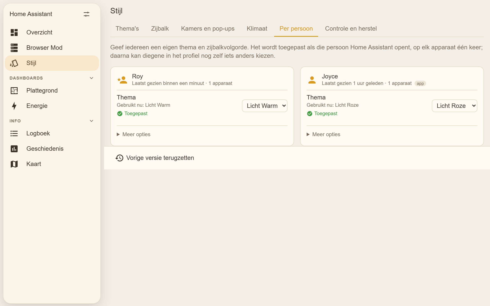
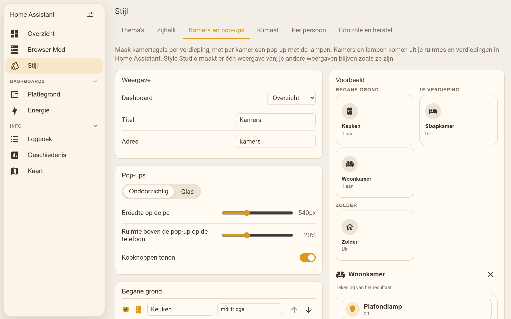
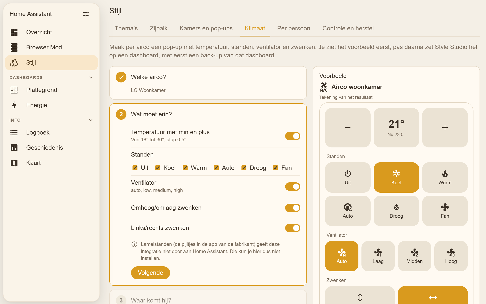
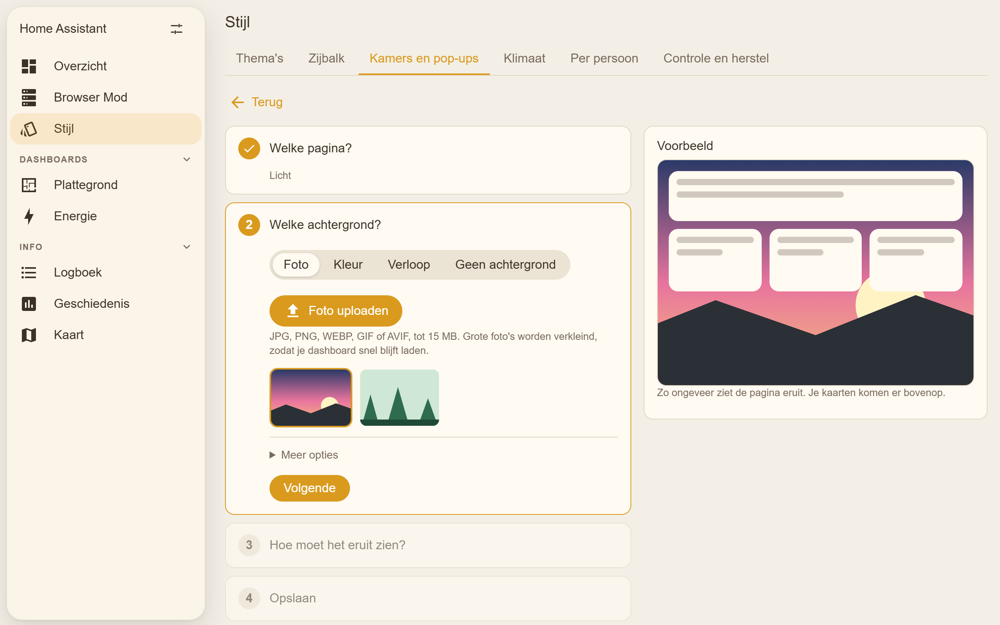
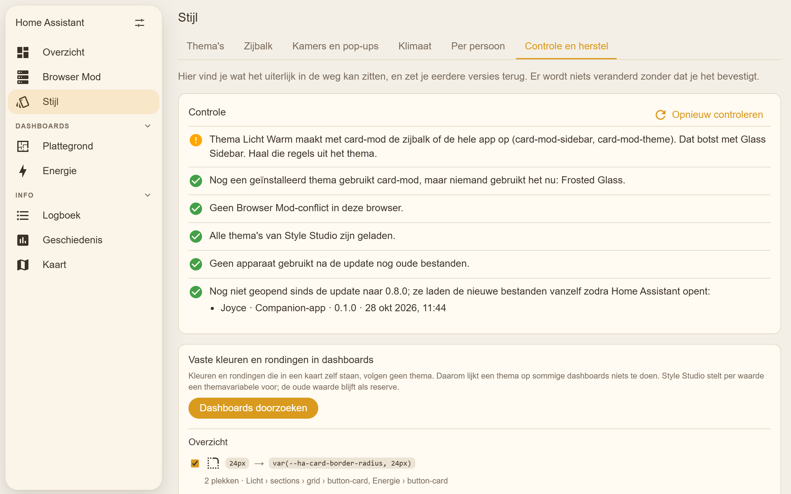
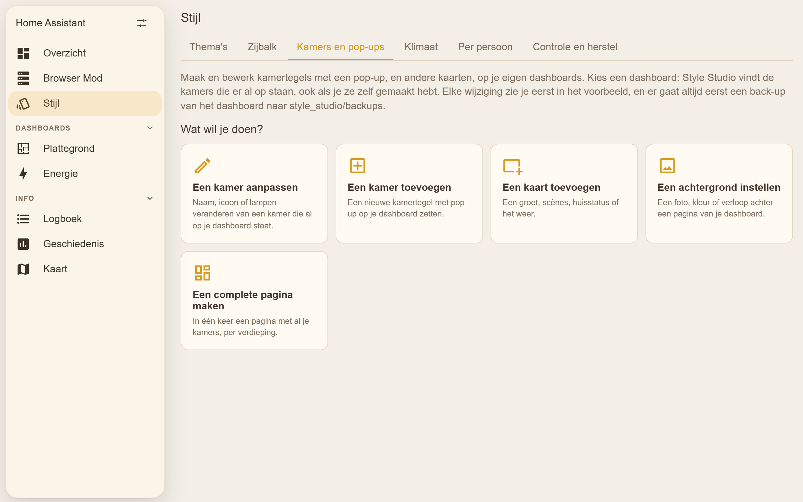

# Style Studio for Home Assistant

[](https://hacs.xyz/docs/faq/custom_repositories)


Set the look of your whole Home Assistant from one panel: menu, top bar, cards,
pop-ups, dialogs, switches and more. Pick a few colors, see the result right
away, and save. No YAML, no CSS.

Style Studio is the app. Its add-on
[Glass Sidebar](https://github.com/roykolk20-design/Home-assistant-glasssidebar)
turns the sidebar into a floating glass panel. Together they make the whole;
each lives in its own repository and installs on its own.


> The images on this page come from a test page that mimics Home Assistant.
> Your own panels, names and dashboards will differ. The panel is in Dutch,
> with English for everyone whose Home Assistant is set to another language.

## Features

- **Every color in Home Assistant.** Start from a preset (sand and yellow,
  pink, dark, glass) or a copy of a theme you already have. Choose a
  background, card, text, accent and sidebar color; Style Studio works out all
  the others: top bar, sidebar, cards, Bubble Card pop-ups, dialogs, switches,
  sliders, input fields, states, the climate ring and the weather card.
- **Change everything.** Each of those colors can also be set on its own, with
  any CSS value: hex, `rgba()` or a gradient. Variables that aren't listed,
  for example from another custom card, can be added too.
- **Solid or glass pop-ups**, with a slider for how see-through they are.
  Also card corners, shadow and card opacity.
- **Preview first.** A small Home Assistant screen shows every change. Turn on
  *Also show on this whole screen* to try the theme on your real Home
  Assistant in your own browser, before anyone else sees it.
- **Safe saving.** Themes go to their own file, `themes/style_studio.yaml`.
  Your own theme files are only read, never changed. Every save makes a backup
  and can be undone from the panel.
- **Default theme** for everyone with one button, or **Use for me** to see it
  on your own screen right away.
- **Per person**: give everyone their own theme and sidebar order, for example
  warm sand for one and soft pink for another, or copy everything from one
  person to the next. It is applied when that person opens Home Assistant,
  once on each device, so they can still pick something else in their
  profile. The panel shows what each person uses now and when it was applied.
- **Rooms and pop-ups on your own dashboards**: Style Studio finds the room
  tiles and pop-ups already there, also hand-made ones with button-card
  templates, and changes their name, icon, lights and air conditioning in
  place while their own design stays. New rooms (from your areas, or made by
  hand) go into the section you pick and copy the design of a room that's
  already there. Also a greeting, scenes, house status and weather card, or a
  whole view of rooms per floor at once.
- **Backgrounds**: a photo, a color or a gradient behind a page of your
  dashboard, on one page or on all of them. Upload a photo (big ones are
  shrunk so the dashboard keeps loading fast), pick one you already have in
  `/config/www`, make it darker or lighter so text stays readable, and see it
  in the preview first. One background for every page at once is a theme
  setting.
- **Climate**: a pop-up per air conditioner with a big minus and plus for the
  temperature, buttons for the modes and fan speeds, and swing switches. Only
  what your air conditioner reports is offered; what's missing is explained.
  Preview first, then Style Studio puts it on a dashboard, with an opener
  button, after a backup of that dashboard.
- **Check and restore**: finds what gets in the way of the look (card-mod
  sidebar styles, Browser Mod's leftover default-dashboard setting, themes
  that aren't loaded, devices or the companion app on old files), finds colors
  and corners written into dashboard cards and replaces them with theme
  variables, and restores any kept version or dashboard backup.
- **Sidebar** settings for the Glass Sidebar add-on: floating, corners, blur,
  highlight, phone menu and groups with headings, with a preview at phone,
  tablet and desktop width.

## Screenshots

| Pink, glass pop-ups | Dark |
| --- | --- |
|  |  |

| Change everything | Start a theme |
| --- | --- |
|  |  |

| Per person | Sidebar (Glass Sidebar add-on) |
| --- | --- |
|  |  |

| Rooms and pop-ups | Climate |
| --- | --- |
|  |  |

| Background for a page | Check and restore |
| --- | --- |
|  |  |

| Phone |
| --- |
|  |

## Installation

### Before you start

Home Assistant must load themes from a folder. Most setups already do; if not,
add this to `configuration.yaml` and restart:

```yaml
frontend:
  themes: !include_dir_merge_named themes
```

Both ways of loading a theme folder work, and Style Studio follows yours:

- `!include_dir_merge_named themes`: all Style Studio themes go into
  `themes/style_studio.yaml`.
- `!include_dir_named themes`: every theme gets its own file,
  `themes/<name>.yaml`, because that setting reads one theme per file.

The panel warns when a saved theme isn't loaded.

### HACS

[](https://my.home-assistant.io/redirect/hacs_repository/?owner=roykolk20-design&repository=style-studio&category=integration)

Click the button above, or add it by hand:

1. In Home Assistant, open **HACS**.
2. Open the menu (⋮) in the top right and choose **Custom repositories**.
3. Add `https://github.com/roykolk20-design/style-studio` with type
   **Integration**.
4. Search for **Style Studio** in HACS and download it.
5. Restart Home Assistant.
6. Go to **Settings → Devices & services → Add integration** and choose
   **Style Studio**.
7. The **Stijl** panel appears in the sidebar (for administrators).

For the glass sidebar, install the
[Glass Sidebar](https://github.com/roykolk20-design/Home-assistant-glasssidebar)
add-on the same way. Its settings then show up in the panel's *Zijbalk* tab.

### Manual

1. Download this repository (green **Code** button → **Download ZIP**).
2. Copy `custom_components/style_studio` into the `custom_components` folder of
   your Home Assistant configuration.
3. Restart Home Assistant and add the integration as in step 6 above.

## Using it

Open **Stijl** in the sidebar. Every tab starts with **"Wat wil je doen?"**
(what do you want to do?) and a few big buttons. After a choice you go
through short, numbered steps; only the current step is open, with
**Volgende** (next) to go on, and the preview beside it. Settings most people
never need sit under **Meer opties** (more options). **Terug** brings you back
to the start. Icons are picked from a grid or by searching, for example
"badkamer" or "bath".



### Themes

1. Choose a preset, or pick one of your existing themes to copy.
2. Give it a name and set the colors under **Snel** (quick). Everything else
   follows.
3. Open **Alles aanpassen** (change everything) to set any single color. An
   empty field uses the worked-out color, shown in grey. The restore button
   puts a color back.
4. Watch the preview, or switch on **Ook tonen op dit hele scherm** to try it
   on your whole screen.
5. Choose **Opslaan** (save). The theme is written and Home Assistant reloads
   its themes.
6. Choose **Voor mij gebruiken** (use for me) to see it on your screen, pick it
   in your profile, or choose **Standaard voor iedereen** to make it the default
   for everyone who didn't choose a theme themselves.

*Vorige versie terugzetten* undoes the last save or delete. Older copies of the
themes file are kept in `config/style_studio/backups/`.

A few places in Home Assistant's own settings pages use fixed colors that no
theme can change.

### Per person

The **Per persoon** tab lists everyone with a login. For each person pick a
**theme** and a **sidebar** order (copied from how someone's sidebar looks
now), or copy everything from another person, then choose **Opslaan**. Each
person's browser applies it the next time they open Home Assistant: the theme
the way the profile page does, the sidebar order through Home Assistant's own
user settings. A green *Toegepast* (applied) appears once their device has
reported back. *Zelf kiezen* leaves it to the person.

This needs a small script in every browser, which Style Studio adds by
itself. It also tells the panel which version each device runs, so you can
see when the companion app still uses old files.

### Rooms and pop-ups

Pick a dashboard in the **Kamers en pop-ups** tab. Style Studio lists the
rooms on it: every Bubble Card pop-up (`#l-woonkamer`) with the tile that
opens it. Hand-made ones count too, including button-card templates with
`const NAME`, `const ICON` and `const LIGHTS`.

- **Change a room**: name, icon, lights and the air conditioning button.
  Only those values change in your own cards; styles and templates stay. New
  light cards in the pop-up copy the look of the first one.
- **Add a room**: from your areas (dashed buttons) or by hand with
  *Kamer toevoegen*. Pick the view and section (a room from an area goes to
  the section named after its floor) and the design: *like* a room that's
  already there, or Style Studio's own.
- **Other cards**: a greeting with the day, lights on, who's home and the
  temperature; scenes; house status (low batteries, devices offline); weather.
  These are Home Assistant's own cards.
- **A whole view**: at the bottom, *Complete weergave maken* still makes one
  view with a column per floor from your areas.

The preview shows the real cards in Home Assistant. Every change makes a
backup of the dashboard first.

**Bubble Card 3.2** writes pop-ups in a new, "standalone" format (the content
in `cards:` instead of a vertical-stack). New pop-ups use that format; choose
*Oud* under *Pop-up-vorm* for an older Bubble Card. Rooms in either format
are found and changed.

### Backgrounds

Under **Kamers en pop-ups** choose **Een achtergrond instellen**:

1. **Which page?** The pages of your dashboard; tick one, several, or all.
   Pages that already have a background are marked.
2. **Which background?** A **photo** (upload one, or pick a picture from the
   list; photos in `/config/www` appear there by themselves), a **color**, a
   **gradient**, or **no background** to remove it.
3. **How should it look?** (photos) Cover, show whole or repeat; **darker or
   lighter** with a slider; stay in place when you scroll; and where on the
   screen it sits.
4. **Save.** The dashboard is backed up first, and only the pages you ticked
   change.

Uploaded photos live in `config/style_studio/backgrounds/` and are served at
`/style_studio_backgrounds/…`, without a login, like `/local`: browsers load a
background before anything else. Don't upload anything private. Photos can be
JPG, PNG, WEBP, GIF or AVIF up to 15 MB.

For **all pages at once**, set `lovelace-background` in your theme (*Alles
aanpassen › Dashboardpagina's*): a color, a gradient or `url(...)`. A page's own
background wins over the theme's.

### Climate

The **Klimaat** tab lists every `climate` entity. For each one, pick the name
and address (for example `#airco-woonkamer`), which modes to show, and whether
to include temperature, fan and swing. Parts your air conditioner doesn't
report are greyed out with the reason; louver positions, for example, aren't
passed on by the LG ThinQ integration.

Then pick a dashboard and view and choose **Op dashboard zetten**. Style Studio
first saves a backup of that dashboard to
`config/style_studio/backups/dashboards/`, then adds the pop-up and an opener
button. Doing it again replaces the earlier pop-up instead of adding a second
one. Dashboards in YAML mode can't be changed; copy the card code instead.

The pop-up needs [button-card](https://github.com/custom-cards/button-card)
and [Bubble Card](https://github.com/Clooos/Bubble-Card) from HACS. The active
button uses `--state-climate-active-color`, so it follows each person's theme.

### Check and restore

The **Controle en herstel** tab checks:

- themes that style the sidebar with card-mod (`card-mod-sidebar`), which
  clashes with Glass Sidebar;
- Browser Mod's `default_dashboard_plugin_conflict` in this browser, with a
  button to clear the leftover setting;
- Style Studio themes that Home Assistant doesn't load;
- devices and companion apps that still run old files, per person.

**Fixed colors and corners.** Colors and corners written into a card (common
in button-card, Bubble Card and card-mod styles) don't follow any theme, so a
theme seems to do nothing on those dashboards. *Dashboards doorzoeken*
lists them per dashboard. A color that matches a color of the theme you use
now gets that theme variable as suggestion, for example
`var(--primary-color, #F59E0B)`; corners get
`var(--ha-card-border-radius, 24px)`. The old value stays as a fallback.
Choose per value what to replace; every dashboard is backed up first.

**Backups and history.** Every dashboard backup and every kept version of
themes, Glass Sidebar settings and per-person settings is listed, and any of
them can be restored. What is there now is kept first.

### Sidebar

With the Glass Sidebar add-on installed, the **Zijbalk** tab sets its shape,
glass, highlight, phone menu and groups. Glass Sidebar 1.5 and newer has its
own, fuller settings page (styles, tint, icons per group, quick menu); the tab
links to it, and keeps what you set there. Changes apply to everyone after
**Opslaan**. Without the add-on, the tab explains how to add it; the sidebar
colors are part of your theme either way.

## Troubleshooting

**My theme says "niet geladen" (not loaded).**
Home Assistant doesn't read the `themes` folder. Add the `frontend:` lines from
*Before you start* and restart.

**Saving says the file already exists.**
There is a `themes/style_studio.yaml` that Style Studio didn't make. It never
overwrites such a file; rename or remove it first.

**The panel looks old after an update.**
Reload the page. In the companion app: *Settings → Companion app →
Troubleshooting → Reset frontend cache*. The panel warns when this is needed.

## Uninstall

1. **Settings → Devices & services → Style Studio → ⋮ → Delete**. The panel
   disappears.
2. Remove it in HACS (or delete `custom_components/style_studio`) and restart.
3. Your themes stay in `themes/style_studio.yaml` until you delete that file.

## Development

```sh
npm install
npm run build              # frontend/src → custom_components/style_studio/www/studio-panel.js
npm run check              # version is the same in manifest.json, const.py and version.js
npm run smoke              # Edge at 430, 768 and 1920 px against dev/harness.html
node dev/serve.mjs         # then open http://localhost:8123/dev/harness.html
node dev/screenshots.mjs   # the images in images/
node dev/brand/render.mjs  # the brand icons from dev/brand/icon.svg
```

`dev/harness.html` mimics Home Assistant with a fake backend and loads Glass
Sidebar's real script from `../Home assistant setting bar` (or
`GLASS_SIDEBAR_DIR`). Home Assistant itself doesn't run on Windows, so the
backend tests run in Docker; the second mount is optional and adds tests
against the real Glass Sidebar:

```sh
docker build -t style-studio-test -f dev/Dockerfile.test dev
docker run --rm -v "$PWD:/src:ro" -v "$PWD/../Home assistant setting bar:/glass:ro" style-studio-test
```

`dev/real-ha.mjs` starts a real Home Assistant in Docker (port 8124) with
Style Studio and Glass Sidebar, onboarded with a test user;
`dev/real-ha-check.mjs` then makes a theme and picks it for a person in the
real frontend. `THEMES_LAYOUT=named` switches to `!include_dir_named`.

To release: raise the version in the three places `npm run check` names,
update `CHANGELOG.md`, build, and push a tag `vX.Y.Z`.

## License

MIT
