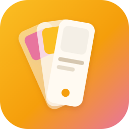
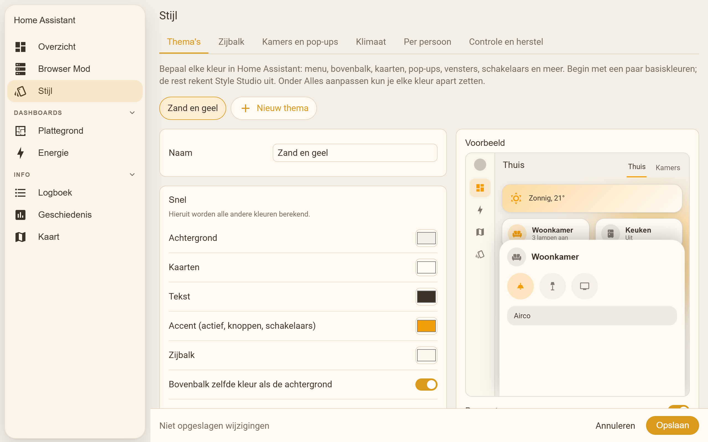
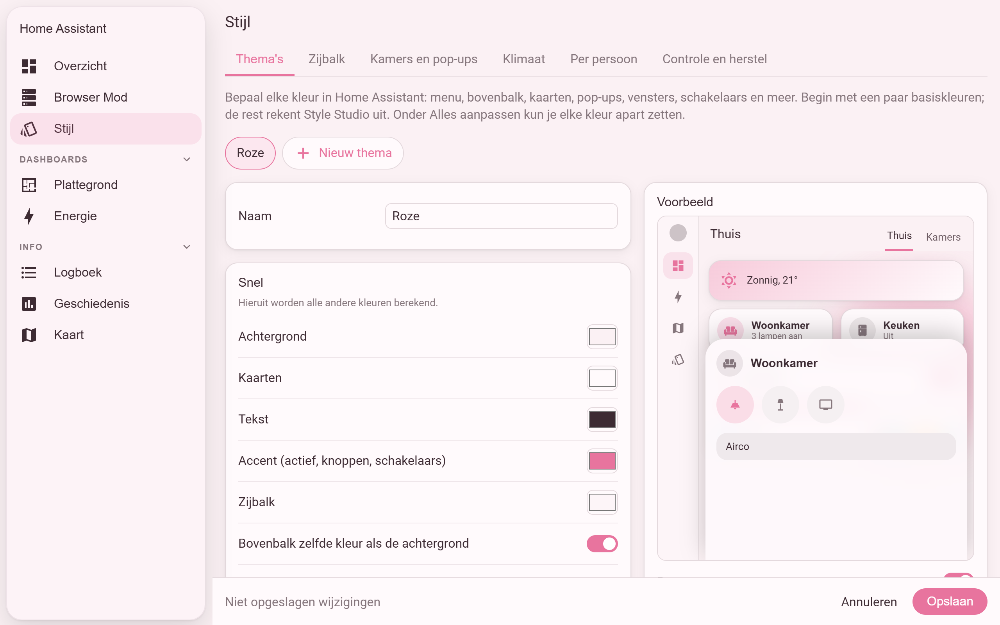
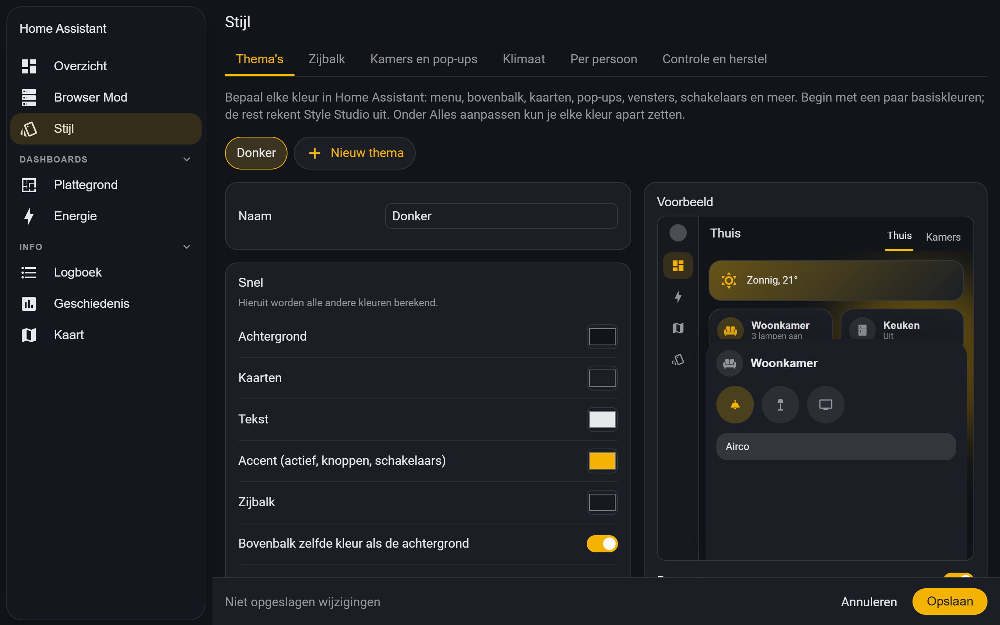
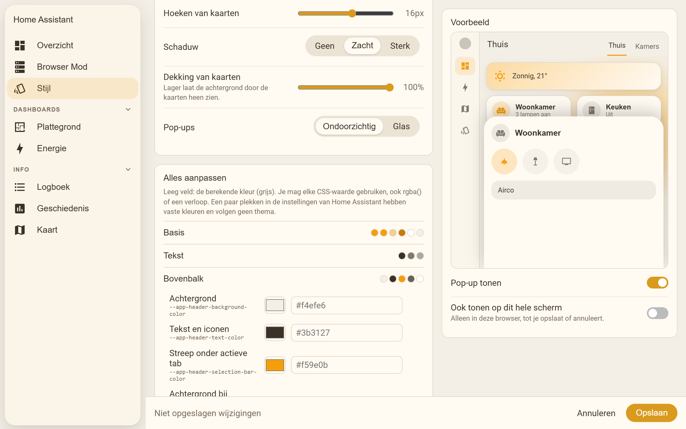
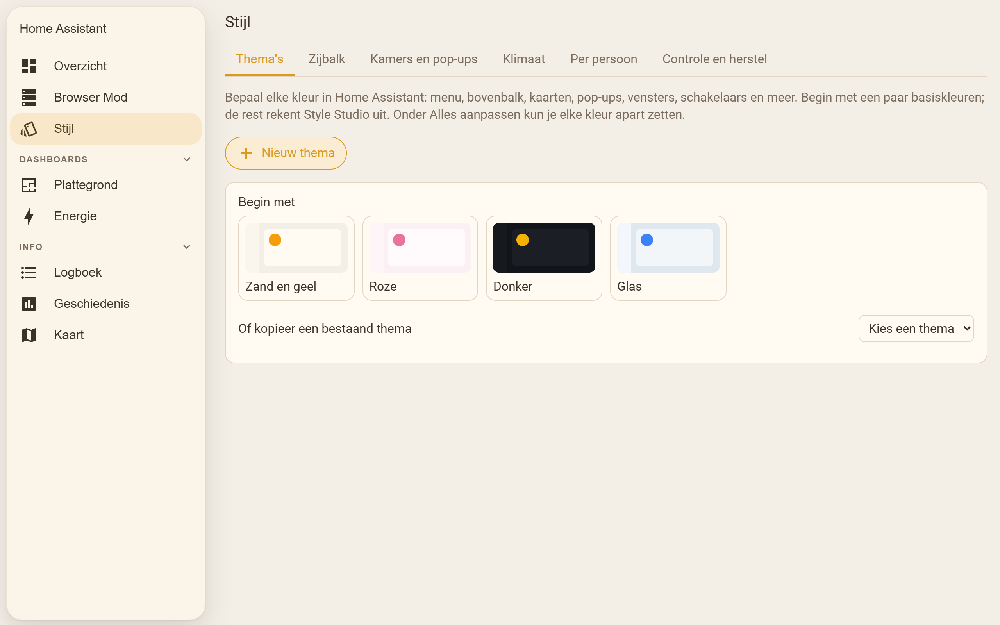
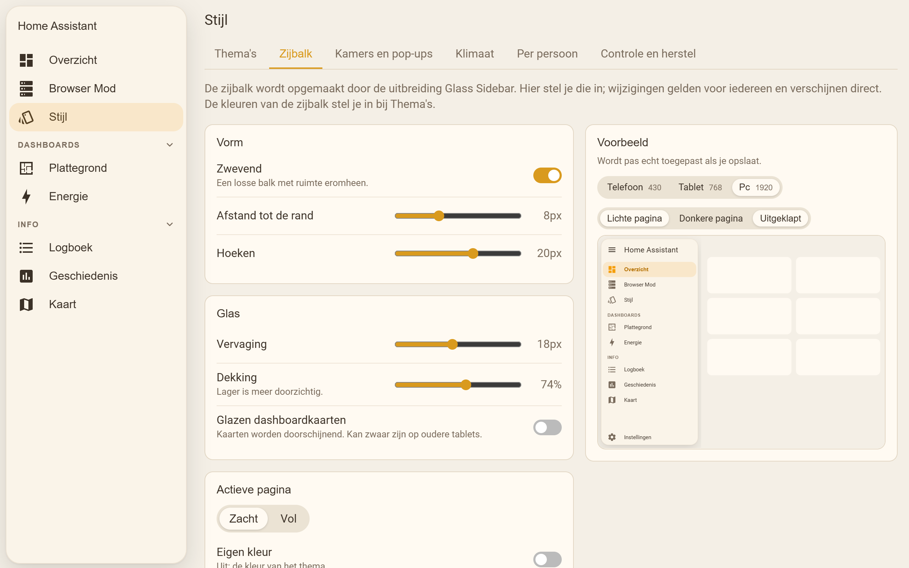
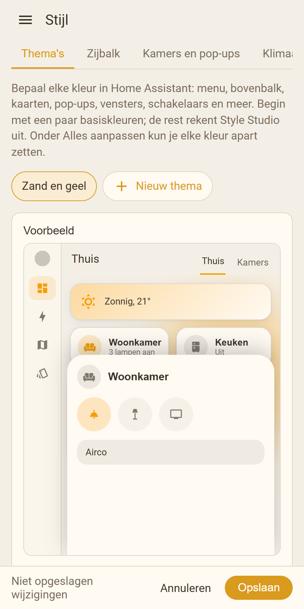

# Style Studio for Home Assistant

[](https://hacs.xyz/docs/faq/custom_repositories)


Set the look of your whole Home Assistant from one panel: menu, top bar, cards,
pop-ups, dialogs, switches and more. Pick a few colors, see the result right
away, and save. No YAML, no CSS.

Style Studio is the app. Its add-on
[Glass Sidebar](https://github.com/roykolk20-design/Home-assistant-glasssidebar)
turns the sidebar into a floating glass panel. Together they make the whole;
each lives in its own repository and installs on its own.



> The images on this page come from a test page that mimics Home Assistant.
> Your own panels, names and dashboards will differ. The panel is in Dutch,
> with English for everyone whose Home Assistant is set to another language.

## Features

- **Every color in Home Assistant.** Start from a preset (sand and yellow,
  pink, dark, glass) or a copy of a theme you already have. Choose a
  background, card, text, accent and sidebar color; Style Studio works out all
  the others: top bar, sidebar, cards, Bubble Card pop-ups, dialogs, switches,
  sliders, input fields, states, the climate ring and the weather card.
- **Change everything.** Each of those colors can also be set on its own, with
  any CSS value: hex, `rgba()` or a gradient. Variables that aren't listed,
  for example from another custom card, can be added too.
- **Solid or glass pop-ups**, with a slider for how see-through they are.
  Also card corners, shadow and card opacity.
- **Preview first.** A small Home Assistant screen shows every change. Turn on
  *Also show on this whole screen* to try the theme on your real Home
  Assistant in your own browser, before anyone else sees it.
- **Safe saving.** Themes go to their own file, `themes/style_studio.yaml`.
  Your own theme files are only read, never changed. Every save makes a backup
  and can be undone from the panel.
- **Default theme** for everyone with one button.
- **Sidebar** settings for the Glass Sidebar add-on: floating, corners, blur,
  highlight, phone menu and groups with headings, with a preview at phone,
  tablet and desktop width.

## Screenshots

| Pink, glass pop-ups | Dark |
| --- | --- |
|  |  |

| Change everything | Start a theme |
| --- | --- |
|  |  |

| Sidebar (Glass Sidebar add-on) | Phone |
| --- | --- |
|  |  |

## Installation

### Before you start

Home Assistant must load themes from the `themes` folder. Most setups already
do; if not, add this to `configuration.yaml` and restart:

```yaml
frontend:
  themes: !include_dir_merge_named themes
```

The panel warns when a saved theme isn't loaded.

### HACS

[](https://my.home-assistant.io/redirect/hacs_repository/?owner=roykolk20-design&repository=style-studio&category=integration)

Click the button above, or add it by hand:

1. In Home Assistant, open **HACS**.
2. Open the menu (⋮) in the top right and choose **Custom repositories**.
3. Add `https://github.com/roykolk20-design/style-studio` with type
   **Integration**.
4. Search for **Style Studio** in HACS and download it.
5. Restart Home Assistant.
6. Go to **Settings → Devices & services → Add integration** and choose
   **Style Studio**.
7. The **Stijl** panel appears in the sidebar (for administrators).

For the glass sidebar, install the
[Glass Sidebar](https://github.com/roykolk20-design/Home-assistant-glasssidebar)
add-on the same way. Its settings then show up in the panel's *Zijbalk* tab.

### Manual

1. Download this repository (green **Code** button → **Download ZIP**).
2. Copy `custom_components/style_studio` into the `custom_components` folder of
   your Home Assistant configuration.
3. Restart Home Assistant and add the integration as in step 6 above.

## Using it

Open **Stijl** in the sidebar.

### Themes

1. Choose a preset, or pick one of your existing themes to copy.
2. Give it a name and set the colors under **Snel** (quick). Everything else
   follows.
3. Open **Alles aanpassen** (change everything) to set any single color. An
   empty field uses the worked-out color, shown in grey. The restore button
   puts a color back.
4. Watch the preview, or switch on **Ook tonen op dit hele scherm** to try it
   on your whole screen.
5. Choose **Opslaan** (save). The theme is written and Home Assistant reloads
   its themes.
6. Pick it in your profile, or choose **Standaard voor iedereen** to make it
   the default for everyone who didn't choose a theme themselves.

*Vorige versie terugzetten* undoes the last save or delete. Older copies of the
themes file are kept in `config/style_studio/backups/`.

A few places in Home Assistant's own settings pages use fixed colors that no
theme can change.

### Sidebar

With the Glass Sidebar add-on installed, the **Zijbalk** tab sets its shape,
glass, highlight, phone menu and groups. Changes apply to everyone after
**Opslaan**. Without the add-on, the tab explains how to add it; the sidebar
colors are part of your theme either way.

## Coming next

The panel already shows tabs for these; they arrive in later versions:

- **Rooms and pop-ups**: room tiles and Bubble Card pop-ups from a few choices.
- **Climate**: a pop-up per air conditioner with modes, fan and swing.
- **People**: each person their own theme and sidebar.
- **Check and restore**: find conflicts such as card-mod sidebar styles, and
  restore backups.

## Troubleshooting

**My theme says "niet geladen" (not loaded).**
Home Assistant doesn't read the `themes` folder. Add the `frontend:` lines from
*Before you start* and restart.

**Saving says the file already exists.**
There is a `themes/style_studio.yaml` that Style Studio didn't make. It never
overwrites such a file; rename or remove it first.

**The panel looks old after an update.**
Reload the page. In the companion app: *Settings → Companion app →
Troubleshooting → Reset frontend cache*. The panel warns when this is needed.

## Uninstall

1. **Settings → Devices & services → Style Studio → ⋮ → Delete**. The panel
   disappears.
2. Remove it in HACS (or delete `custom_components/style_studio`) and restart.
3. Your themes stay in `themes/style_studio.yaml` until you delete that file.

## Development

```sh
npm install
npm run build              # frontend/src → custom_components/style_studio/www/studio-panel.js
npm run check              # version is the same in manifest.json, const.py and version.js
npm run smoke              # Edge at 430, 768 and 1920 px against dev/harness.html
node dev/serve.mjs         # then open http://localhost:8123/dev/harness.html
node dev/screenshots.mjs   # the images in images/
node dev/brand/render.mjs  # the brand icons from dev/brand/icon.svg
```

`dev/harness.html` mimics Home Assistant with a fake backend and loads Glass
Sidebar's real script from `../Home assistant setting bar` (or
`GLASS_SIDEBAR_DIR`). Home Assistant itself doesn't run on Windows, so the
backend tests run in Docker; the second mount is optional and adds tests
against the real Glass Sidebar:

```sh
docker build -t style-studio-test -f dev/Dockerfile.test dev
docker run --rm -v "$PWD:/src:ro" -v "$PWD/../Home assistant setting bar:/glass:ro" style-studio-test
```

To release: raise the version in the three places `npm run check` names,
update `CHANGELOG.md`, build, and push a tag `vX.Y.Z`.

## License

MIT
